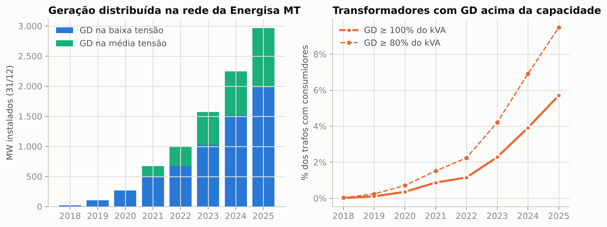
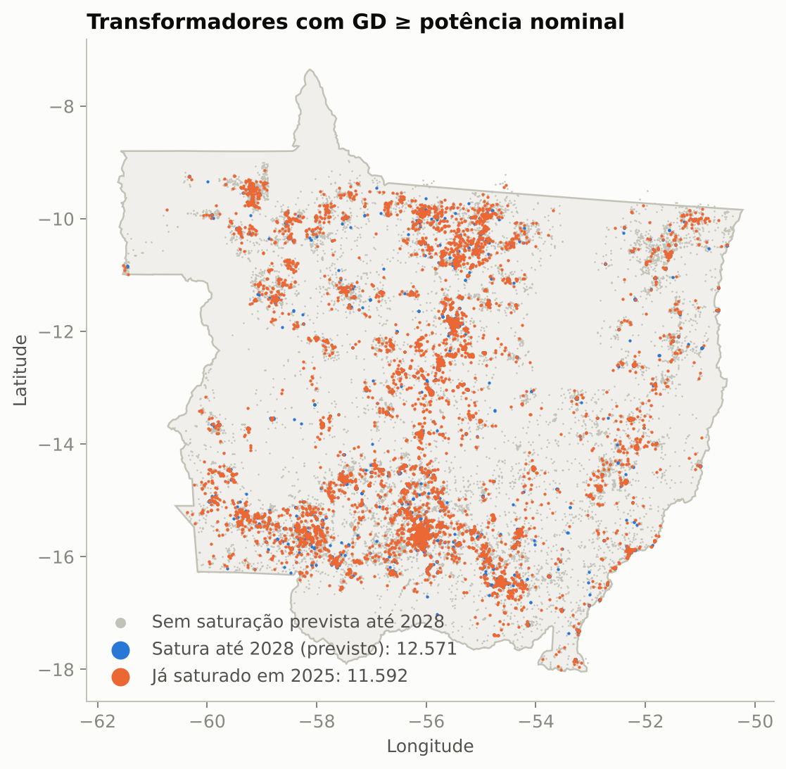
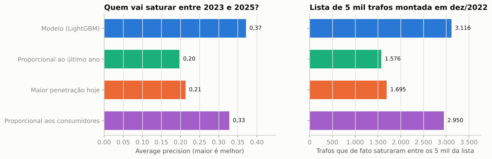
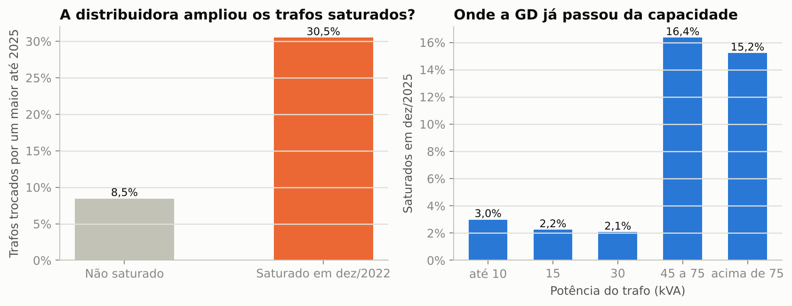
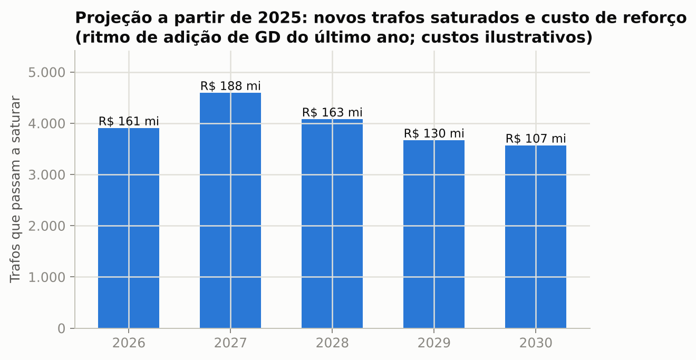

# Geração distribuída × capacidade da rede

[](https://github.com/CaioNepomuceno2/gd-hosting-capacity/actions/workflows/ci.yml)


**Quais transformadores vão saturar com a energia solar dos telhados, e quando?**

Em Mato Grosso, a geração distribuída (GD) de baixa tensão passou de **18 MW em 2018 para 1,97 GW em 2025**
(214 mil unidades). Este projeto mede, com o cadastro público da rede (BDGD/ANEEL), quantos transformadores da
**Energisa Mato Grosso** já têm mais GD do que potência nominal, prevê quais serão os próximos e estima o custo
de reforço, usando apenas dados abertos.

## Resultados em uma tela

| | |
|---|---|
| Trafos com GD ≥ potência nominal, dez/2025 | **11.592** (5,7% dos trafos com consumidores), contra 2.307 em 2022 |
| Trafos com GD ≥ 80% da potência, dez/2025 | 9,5% |
| Lista de 1.000 trafos para reforço montada em dez/2022: quantos de fato saturaram até 2025? | **802 com o modelo**, 657 com a melhor regra simples, 362 priorizando a maior penetração atual |
| Trafos saturados em 2022 que a distribuidora trocou por um maior até 2025 | **30,5%**, contra 8,5% dos demais |
| Projeção 2026-2030 (ritmo de 2025, custos ilustrativos) | +19,8 mil trafos saturados, ~R$ 750 mi em reforços |



A metodologia completa (definições, fórmulas, desenho do backtest e premissas) está em
[`docs/metodologia.md`](docs/metodologia.md).

## Na prática: o que muda para quem decide

### O problema hoje

Sem uma lista antecipada, o reforço de trafo por causa de GD tende a ser reativo. A obra aparece quando um pedido
de conexão exige estudo, quando um cliente reclama de tensão alta ou quando o trafo é trocado depois de um defeito.
Os números deste projeto dão a escala disso na Energisa MT:

* **13.241 trafos** que não estavam saturados em dez/2022 saturaram até dez/2025.
* Dos 2.239 trafos que já estavam saturados em 2022, **1.556 (69%) continuavam com o mesmo kVA em 2025**
  ([`reports/resumo_decisao.json`](reports/resumo_decisao.json)).
* Priorizar pela regra intuitiva, "onde já tem mais GD", põe **metade do dinheiro antecipado em trafos que não
  saturam** no horizonte: só 49% do R$ da lista de 1.000 cairia em trafos que de fato saturaram.

### O que se ganha

| Ganho | Quanto | De onde vem o número |
|---|---|---|
| Uma lista que acerta mais | 802 dos 1.000 trafos da lista de dez/2022 saturaram até 2025, contra 657 com a melhor regra simples e 362 com "maior penetração hoje" | **Medido:** backtest point-in-time ([`backtest_reforco_rs.csv`](reports/backtest_reforco_rs.csv)) |
| Dinheiro antecipado no lugar certo | 84% do R$ da lista de 1.000 vai para trafos que saturaram, contra 71% (proporcional aos consumidores) e 49% (maior penetração) | **Medido** (acertos) com **custo ilustrativo** ([`resumo_decisao.csv`](reports/resumo_decisao.csv)) |
| Antecedência | a lista montada em dez/2022 acerta o que acontece até dez/2025: até 3 anos para programar a obra | **Desenho** do backtest |
| Um critério ligado ao problema real | trafos saturados em 2022 foram trocados por um maior 3,6 vezes mais (30,5% contra 8,5%) | **Medido** ([`validacao_ampliacao_trafos.csv`](reports/validacao_ampliacao_trafos.csv)) |
| Orçamento plurianual | 3.903 trafos e cerca de R$ 161 mi em 2026; cerca de R$ 750 mi de 2026 a 2030 | **Premissa:** ritmo de 2025 e custos ilustrativos ([`projecao_reforco.csv`](reports/projecao_reforco.csv)) |

O ganho não é gastar menos com reforço, porque a GD vai continuar chegando. É gastar no trafo certo, antes do
problema, com obra programada em vez de emergencial. A diferença de custo entre obra programada e emergencial
não foi medida aqui.

### Por que aplicar

* **Conexão de micro e minigeração é obrigação da distribuidora, com prazos regulados** (REN ANEEL 1.000/2021 e
  Lei 14.300/2022). Quando a conexão provoca inversão do fluxo de potência no posto de transformação, a
  distribuidora pode exigir obras. Se a obra só é descoberta na análise do pedido, ela entra no caminho crítico
  da conexão. Com a lista, ela pode ser feita antes.
* **Qualidade do produto:** GD acima da capacidade do trafo eleva a tensão no secundário ao meio-dia. A tensão em
  regime permanente é acompanhada pelos indicadores DRP e DRC do PRODIST Módulo 8, com compensação ao consumidor
  quando os limites são violados, além de gerar reclamações.
* **Plano de obras com justificativa:** a lista com ano previsto de saturação entra no plano de investimentos e no
  orçamento plurianual, com um critério explícito e reproduzível para defender cada obra.
* **O crescimento continua:** foram 546 MW de GD nova na baixa tensão só em 2025, e no backtest a regra do
  último ano subestimou o crescimento em 30%.

### Como aplicar (roteiro de adoção)

1. **Trocar ou complementar os dados públicos por dados internos.**
   * Cadastro de GD do sistema comercial com a **data do pedido**, não só a da conexão. Isso antecipa o sinal em
     meses.
   * Pedidos de conexão em análise **por trafo**. O dado público não identifica o trafo; o interno identifica.
   * **Telemetria de subestações e religadores:** a potência ativa no disjuntor do alimentador e nos religadores
     com medição mostra fluxo reverso ao meio-dia. Isso substitui a premissa mais sensível do projeto (o fator
     de simultaneidade, que leva de 19% a 82% dos alimentadores acima do critério) por medição.
   * Medidores inteligentes ou telemedição de trafos e as reclamações de tensão, para confirmar a saturação.
   * GIS, para a topologia do secundário.
2. **Calibrar as premissas** em [`configs/premissas.yaml`](configs/premissas.yaml): o limite usado pela
   engenharia (por exemplo, um critério de tensão), os tamanhos padrão e o custo do banco de preços, e o fator
   de simultaneidade medido.
3. **Piloto de um trimestre:** medir ou inspecionar os 200 primeiros trafos da lista de 2026 (tensão no
   secundário ao meio-dia, fluxo reverso) e uma amostra aleatória de trafos com GD como controle. O indicador
   é a fração de trafos com problema confirmado em cada grupo. A referência do backtest é 80% de acerto na lista
   de 1.000.
4. **Rotina:**
   * rodar o pipeline a cada novo snapshot, ou todo mês com os dados internos;
   * publicar no Power BI: `data/processed/trafos_previsao.parquet` (uma linha por trafo, com alimentador,
     município, kVA, GD e ano previsto de saturação) e `reports/alimentadores_previsao.csv` já estão nesse
     formato;
   * um robô pode cruzar cada pedido de conexão novo com a lista e alertar quando ele cai num trafo previsto
     para saturar.

   Quem usa: o planejamento (plano de obras), o atendimento a acessantes (prazos de conexão) e a qualidade e
   operação (reclamações de tensão).
5. **Critérios de sucesso:**
   * fração das obras de reforço por GD feitas antes da saturação;
   * prazo médio de conexão em trafos da lista contra os demais;
   * reclamações de tensão nos trafos tratados;
   * acerto da lista a cada novo snapshot.

### Limites de uso

* **Não é estudo de fluxo de potência.** A lista diz onde medir e estudar primeiro, não aprova a obra.
* **Os R$ são ilustrativos.** Servem para comparar estratégias, não como orçamento.
* **O total de GD futura é incerto.** Confie mais na ordem da lista do que no número de trafos por ano.
* **O critério de alimentador é triagem** e depende muito do fator de simultaneidade.

## 1. Diagnóstico: a saturação quintuplicou em três anos

Critério: **GD instalada na baixa tensão ≥ potência nominal do trafo** (kW ≥ kVA), um indicador simples de risco
de inversão de fluxo no posto de transformação (ver [premissas](configs/premissas.yaml)).

| Ano | Unidades de GD na BT | GD na BT | Trafos saturados | % dos trafos com consumidores |
|---|---|---|---|---|
| 2019 | 7,6 mil | 106 MW | 191 | 0,1% |
| 2021 | 42,1 mil | 495 MW | 1.588 | 0,9% |
| 2022 | 66,3 mil | 673 MW | 2.307 | 1,2% |
| 2023 | 103,0 mil | 1.027 MW | 4.359 | 2,3% |
| 2024 | 160,1 mil | 1.516 MW | 7.673 | 3,9% |
| 2025 | 214,2 mil | 1.974 MW | 11.592 | 5,7% |

**O que isso significa:** o número de trafos saturados cresceu mais rápido que a própria GD. A GD de BT
triplicou de 2022 a 2025, e os trafos saturados quintuplicaram, porque cada trafo que cruza o limite continua
recebendo GD.

* **O problema está nos trafos de 45 kVA para cima:** 16,4% dos trafos de 45 a 75 kVA e 15,2% dos acima de 75 kVA
  já estão saturados, contra 3,0% dos de até 10 kVA (em geral rurais, com um ou dois consumidores).
* **Concentração urbana:** Cuiabá (1.531 trafos saturados), Rondonópolis (683), Várzea Grande (656; 16,4% dos
  trafos da cidade), Sinop (632) e Sorriso (396).



## 2. Backtest: quem ia saturar entre 2023 e 2025?

Em dez/2022, com o que se sabia naquela data, o modelo ordena os trafos pela chance de saturar nos três anos
seguintes. O resultado é comparado com o cadastro de dez/2025. O treino só usa janelas cujo resultado já era
conhecido em 2022: (2019→2020/2021/2022), (2020→2021/2022) e (2021→2022).

O modelo (LightGBM) prevê **para onde vai o crescimento**: a fração da GD nova do sistema que cai em cada trafo.
Ele usa o porte do trafo, os consumidores e a folga por consumidor, a GD já instalada, o crescimento recente
no trafo, na vizinhança de 500 m, no alimentador e no município. As regras de comparação distribuem o mesmo
total de outras formas.



| Origem dez/2022, alvo dez/2025 (197 mil trafos não saturados; 13.241 saturaram) | Modelo | Proporcional aos consumidores | Maior penetração hoje | Proporcional ao último ano |
|---|---|---|---|---|
| Average precision (ranking de quem satura) | **0,37** | 0,33 | 0,21 | 0,20 |
| Acertos entre os 1.000 primeiros da lista | **802** | 657 | 362 | 153 |
| Acertos entre os 5.000 primeiros | **3.116** | 2.950 | 1.695 | 1.576 |
| Erro absoluto médio do kW adicionado por trafo | **4,8 kW** | 5,0 kW | 7,0 kW | 7,8 kW |

**O que isso significa:** com um orçamento para 1.000 reforços preventivos em dez/2022, a lista do modelo teria
acertado 4 de cada 5 trafos. A regra intuitiva acertaria cerca de 1 em cada 3. Uma lista aleatória teria
average precision de 0,07 (a taxa de saturação no período), contra 0,37 do modelo.

**Em reais** (custos ilustrativos): se em dez/2022 a distribuidora reforçasse preventivamente os 1.000 primeiros
trafos de cada lista, com o modelo **R$ 37 mi** iriam para trafos que de fato saturaram e R$ 7 mi seriam
antecipados sem necessidade. Priorizando a maior penetração atual, que é a regra intuitiva, seriam R$ 18 mi bem
gastos e R$ 19 mi sem necessidade ([`reports/backtest_reforco_rs.csv`](reports/backtest_reforco_rs.csv)).

A regra "proporcional aos consumidores" é um baseline forte: sozinha, ela já captura a maior parte do sinal
(trafo pequeno com muitos consumidores satura primeiro). O modelo fica à frente principalmente no topo da
lista, que é onde o orçamento de reforço é gasto. A alocação é bem calibrada por decil
([`reports/calibracao_alocacao.csv`](reports/calibracao_alocacao.csv)).

**O total é a parte difícil.** A regra simples "o ritmo do último ano se mantém" previa 818 MW de GD nova na BT
entre 2023 e 2025; entraram 1.161 MW (-30%). Com esse total, o modelo marca menos trafos como saturados
(precisão de 67%, recall de 18%), mas a ordem da lista praticamente não muda (average precision de 0,36).

## 3. Validação externa: a distribuidora trocou os trafos saturados

Se o critério captura um problema real, os trafos saturados deveriam receber obra. Ligando o cadastro de 2022 ao
de 2025 pela posição de cada trafo: **30,5% dos 2.239 trafos saturados em 2022 foram trocados por um maior até
2025, contra 8,5% dos não saturados** (3,6 vezes mais).



## 4. Projeção: o que vem até 2030

Modelo treinado com todas as janelas até 2025. O total de GD nova segue o ritmo de 2025 (546 MW/ano na BT),
que no backtest se mostrou conservador. Cada trafo é reforçado no ano em que cruza o limite.

| Ano | Trafos que passam a saturar | Reforço (R$ mi, ilustrativo) | Saturados acumulados |
|---|---|---|---|
| 2026 | 3.903 | 161 | 15.495 |
| 2027 | 4.592 | 188 | 20.087 |
| 2028 | 4.076 | 163 | 24.163 |
| 2029 | 3.666 | 130 | 27.829 |
| 2030 | 3.565 | 107 | 31.394 |

**O que isso significa:** mantido o ritmo de 2025, o número de trafos saturados quase triplica até 2030. É uma
ordem de grandeza para o orçamento plurianual, não um orçamento: os custos são ilustrativos e, no backtest, a
regra do ritmo subestimou o crescimento.



A lista por trafo (com ano previsto de saturação) fica em `data/processed/trafos_previsao.parquet`. A lista por
alimentador está em [`reports/alimentadores_previsao.csv`](reports/alimentadores_previsao.csv).

**Alimentadores.** A rede da distribuidora tem 2,97 GW de GD (BT + MT) para uma carga média de
1,29 GW. Por isso o critério de alimentador (GD x 0,7 ≥ carga média, ou seja, exportação provável ao meio-dia)
já é atingido por **74% dos 638 alimentadores com carga cadastrada**; outros 45 cruzam em 2026 e 27 em 2027. O
número depende muito do fator de simultaneidade (58% com 0,5; 19% com 0,3;
[`reports/sensibilidade_alimentadores.csv`](reports/sensibilidade_alimentadores.csv)), mas a conclusão se
mantém: no nível do alimentador, a capacidade de hospedagem já foi ultrapassada em boa parte da rede. Daqui
para frente, o problema a priorizar é local, trafo a trafo.

> **Premissas.** Limite de saturação, fator de simultaneidade, tamanhos padrão de trafo e custos estão em
> [`configs/premissas.yaml`](configs/premissas.yaml) e são **ilustrativos**. Os valores em R$ servem para
> comparar estratégias, não como orçamento.

## Decisões de dados que fazem diferença

Os detalhes estão em [`docs/dados.md`](docs/dados.md). Os principais:

* **IDs de trafo instáveis.** Só 0,05% dos códigos de trafo de 2022 existem em 2025. O mesmo trafo é
  reconhecido pela posição (vizinho mais próximo mútuo a até 20 m), o que liga 99,1% dos trafos.
* **GD sumida no modelo antigo da BDGD.** De 2018 a 2020 a camada de GD de baixa tensão vem vazia. As
  unidades foram reconstruídas pelos consumidores com código CEG de GD.
* **Potências impossíveis.** O cadastro de 2025 tem ~2.400 "microgerações" de BT acima de 75 kW (até 43 MW), que
  somariam 1,3 GW. A potência vem do registro oficial de empreendimentos da ANEEL pelo código CEG; sem
  registro, só valem até 75 kW. O mesmo vale para uma GD de MT cadastrada com 125 GW em 2024.

## Estrutura

```
src/gdhc/
  bdgd.py        leitura da BDGD (modelos M10 e V10/V11), GD por trafo, limpeza de potência
  aneel.py       downloads do CKAN da ANEEL
  painel.py      ligação de trafos entre snapshots pela posição, features point-in-time
  modelo.py      alocação do crescimento (LightGBM), baselines e métricas
  rede.py        critério de saturação, custo de reforço, ano de saturação, alimentadores
scripts/         01_baixar_aneel, 02_build_bdgd, 03_analise, 04_validacao, 05_figuras, 06_resumo_decisao
configs/         recorte (distribuidora, snapshots) e premissas de engenharia e custo
docs/dados.md    decisões de dados
docs/metodologia.md  definições, fórmulas, desenho do backtest e premissas
```

## Reproduzir

```bash
pip install -e ".[dev]"
python scripts/01_baixar_aneel.py   # registro de GD e pedidos de conexão (~160 MB)
python scripts/02_build_bdgd.py     # 8 snapshots da BDGD (~1 GB cada, processados e apagados um a um)
python scripts/03_analise.py        # diagnóstico, backtest e projeção (~25 min com 2 núcleos)
python scripts/04_validacao.py      # validações externas (troca de trafos, pedidos de conexão)
python scripts/05_figuras.py
python scripts/06_resumo_decisao.py # indicadores de decisão a partir dos relatórios
pytest
```

Para outra distribuidora, basta trocar a UF, a sigla e os IDs dos snapshots da BDGD em `configs/emt.yaml`.

## Limitações

* **O critério é um indicador, não um estudo de fluxo de potência.** GD ≥ kVA não garante inversão de fluxo
  (depende da carga ao meio-dia), e um trafo pode ter problema de tensão antes disso. O sinal de que ele captura
  algo real é a taxa de troca 3,6 vezes maior nos trafos saturados.
* **Pedidos de conexão não validaram o critério.** Nos pedidos de MMGD de BT de 2022-2023 (ANEEL), a fração com
  "necessidade de obra" por município é *menor* onde há mais trafos saturados (Spearman -0,27, 108
  municípios). Ela acompanha a ruralidade (Spearman -0,55 com a fração de trafos urbanos): nesses dados,
  obra parece significar extensão de rede, e o pedido não identifica o trafo.
* **O total de GD futura é incerto** (políticas, juros, preço dos módulos). A projeção usa o ritmo de 2025; no
  backtest, a mesma regra subestimou o crescimento em 30%.
* **Registro de GD com potência atual:** ampliações posteriores de uma mesma GD aparecem nos snapshots antigos.
* **GD de MT antes de 2021** não está na BDGD da distribuidora, então o histórico por alimentador começa em 2021.
* **Custos ilustrativos:** troca de trafo a R$ 300/kVA + R$ 8 mil por troca. Não incluem reforço de rede
  secundária nem de alimentador.

---
Autor: **Caio Nepomuceno**. Dados públicos da ANEEL. Projeto independente, sem vínculo com a Energisa ou com a ANEEL.
